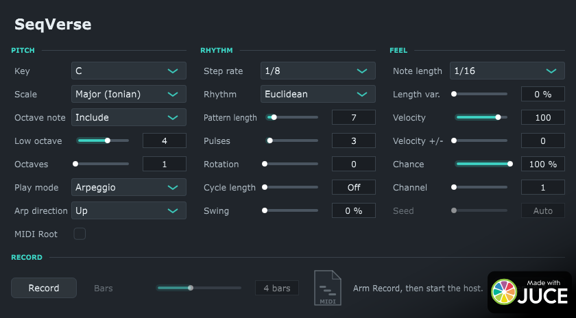

# SeqVerse

A generative MIDI sequencer plugin (CLAP and VST3), built with JUCE 8 and C++17.

SeqVerse follows the host's transport and plays notes from a key and scale: as an arpeggio (15 directions) or at random,
on a straight or Euclidean rhythm, with chance, swing, velocity and length variation. A seed makes the random choices
repeatable, and a cycle length makes the output loop. Any run can be recorded as a MIDI file and dragged into the host.



## Features

- **Pitch:** 12 keys and 43 scales over 1 to 8 octaves. You can include or leave out the octave note. With
  **MIDI Root** on, an incoming note sets the root. Play modes are Arpeggio (Up, Down, Up/Down, Converge, Thumb,
  Pinky, Skip and others) and Random.
- **Rhythm:** step rates from 1/32 to 1/1, triplets included. Every step can play, or use a Euclidean pattern
  (pattern length, pulses, rotation). Swing applies to every other step. A cycle length of 0.5 to 64 beats repeats
  the same notes each cycle.
- **Feel:** note length, length variation, velocity, velocity variation, chance per step, MIDI channel and seed
  (0 = new choices each time).
- **Record:** arm Record and start the host. The notes go into a MIDI file for a set number of bars, or until the
  transport stops. The five newest takes are kept in a `SeqVerse` folder in your music folder, and the editor has a button that opens
  that folder.
- **Locked to the host timeline:** every step follows from the host's PPQ position, so loops, jumps and starting
  mid-song keep the pattern in place.
- **Realtime-safe:** the audio thread does no allocations and takes no locks.

SeqVerse is a MIDI generator: its stereo audio output is silent and only there because some hosts (Bitwig) need an
audio port. Put an instrument after it. SeqVerse does not play incoming MIDI notes.

## Building

You need CMake 3.22 or newer, Ninja and a C++17 compiler. On Linux you also need JUCE's usual dependencies
(`libasound2-dev`, `libfreetype-dev`, `libx11-dev`, `libxrandr-dev`, `libxinerama-dev`, `libxcursor-dev`, and so on).

The project does not include JUCE and clap-juce-extensions and does not download them. It expects them in `~/SDKs`:

```sh
git clone --branch 8.0.15 https://github.com/juce-framework/JUCE.git ~/SDKs/JUCE-8.0.15
git clone --recurse-submodules https://github.com/free-audio/clap-juce-extensions.git ~/SDKs/clap-juce-extensions-main
git -C ~/SDKs/clap-juce-extensions-main checkout 7adee3a && git -C ~/SDKs/clap-juce-extensions-main submodule update --recursive
```

If they are somewhere else, pass `-DJUCE_DIR=...` and `-DCLAP_JUCE_EXTENSIONS_DIR=...`. Then build:

```sh
cmake -S . -B build -G Ninja -DCMAKE_BUILD_TYPE=Release
cmake --build build --target SeqVerse_CLAP SeqVerse_VST3
```

The plugins are written to `build/SeqVerse_artefacts/Release/CLAP/SeqVerse.clap` and `.../VST3/SeqVerse.vst3`. Copy
them to `~/.clap` or `~/.vst3`, or to your platform's plugin folder, and rescan in the host. SeqVerse is developed and
tested on Linux with Bitwig Studio. Other platforms and hosts should work but have not been tried.

Releases: GitHub Actions (`.github/workflows/build.yml`) builds the VST3 and CLAP on Linux, runs the tests and makes
`SeqVerse-<version>-Linux.zip`. A tag such as `v1.0.0` also publishes it as a GitHub release. The version is the one in
`CMakeLists.txt` and is shown in the editor's header.

## Tests

```sh
cmake --build build --target SeqVerse_CLAP clap_test_host SeqVerseUiTest
ctest --test-dir build --output-on-failure
```

- `tests/clap_test_host.cpp` is a small headless CLAP host. It loads the built plugin, runs scripted transport
  scenarios through `process()` and checks each note-on and note-off against expectations written by hand. It covers
  every arp direction, the Euclidean patterns, cycles, seeds, swing, recording and saving and loading state. Run the
  binary directly to see the result of each check.
- `tests/ui_test.cpp` builds the editor without a window and checks which controls are enabled. Given a path prefix,
  it also writes PNG snapshots of the editor.

## Source layout

| Path | Contents |
| --- | --- |
| `src/Music.h` | Keys, scales, arp directions, Euclidean patterns, per-step randomness (no JUCE dependency) |
| `src/PluginProcessor.*` | Parameters, note generation in `processBlock`, state save/load, recording takes |
| `src/Take.h` | The recording buffer and the MIDI file writer |
| `src/PluginEditor.*` | The editor: three panels of knobs, dropdowns and choices, and the Record panel |
| `src/DarkLookAndFeel.h` | The theme: all colours, fonts and control drawing |
| `resources/fonts/` | The editor's fonts, Chakra Petch and JetBrains Mono |
| `tests/` | The headless CLAP test host and the editor test |
| `tools/`, `design/` | Mockups used to compare control styles and layouts |

[`CLAUDE.md`](CLAUDE.md) is the detailed design document. It explains how the timeline is locked to the host, why
parameters never depend on each other, how state stays compatible with older sessions, and the rules for the audio
thread. Read it before changing the generator.

## Contributing

Forks and pull requests are welcome. Keep these rules:

- The build must produce no warnings.
- `processBlock` must not allocate, lock, call into the UI or set parameters.
- New choice entries and new parameters go at the end, so saved sessions still load.
- A behaviour change comes with a scenario in `tests/clap_test_host.cpp`, and `ctest` passes.

## License

SeqVerse is free software under the [GNU Affero General Public License v3.0](LICENSE). This follows from JUCE 8, whose
free license is the AGPLv3 (earlier commits were built with JUCE 7 and released under the GPLv3). The fonts in `resources/fonts/` (Chakra Petch and JetBrains Mono) are under the SIL Open Font
License 1.1, included next to them.
